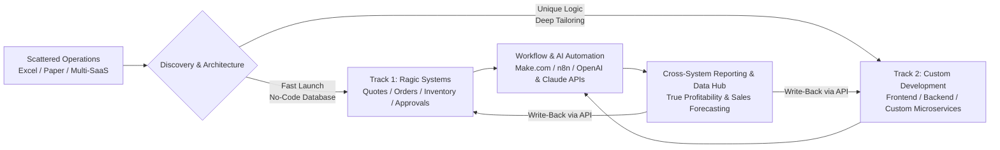

<div align="center">

  

  <p align="center">
    <strong>Building a High-Purity Database for Predictable Enterprise Growth</strong><br>
    <em>From standardized digital form collection to cleansed, structured applications — turning turbulent business data into actionable insight and AI readiness.</em>
  </p>

  <p align="center">
    <a href="https://www.kuroshiodigital.com"></a>
    <a href="mailto:service@kuroshiodigital.com"></a>
    
    
    
  </p>

  ---
</div>

## 🌊 About Kuroshio Digital

> **"Digital transformation shouldn't be blind trial and error. We help companies turn scattered spreadsheets and disconnected tools into structured, maintainable systems their teams can own and run."**

### The Meaning Behind Our Name & Symbol
- **Kuroshio (黒潮) — The Strongest, Steadiest Current:**  
  Every growing business faces a continuous flood of data across operations, sales, logistics, and finance — resembling the invisible yet immense currents of the open ocean. At Kuroshio Digital, we act as your **Data Navigator**, transforming chaotic data into a strong, unified current that carries your business straight toward its goals.
- **The Brand Mark:**  
  The flowing curves symbolize data streams circulating within and across organizational departments. The crimson dot represents the guiding sun — your core business objective.

---

## 🧭 Four Common Challenges We Solve

| Challenge | The Pain Point | The Kuroshio Solution |
| :--- | :--- | :--- |
| **Vendor Lock-In** | A single field or workflow change requires vendor quotes, weeks of waiting, and prohibitive hourly retainers. | **Self-Maintainable Systems:** Built on clean architectures that your team can update on its own without calling back a vendor. |
| **Scattered Data Silos** | Quotes, orders, inventory, and finances live across disconnected spreadsheets and assorted SaaS tools. | **Single Source of Truth:** Centralized database capturing structured, validated records directly from the point of entry. |
| **Data Without Insight** | Month-end reports compiled by hand are slow, error-prone, and outdated the moment they are finished. | **Live Cross-Channel Analytics:** Automated reconciliation and real-time visibility (e.g. true margin across Amazon, Shopify, logistics, and ads). |
| **AI Readiness Gap** | AI adoption stalls because data is dirty, inconsistent, or trapped in unstructured PDFs and emails. | **High-Purity Data Foundations:** Automated data extraction and cleansing pipelines powered by OpenAI & Claude APIs. |

---

## 🛠️ What We Build & How We Work

We don’t believe in one-size-fits-all software. We match your operational complexity with the right technical approach:



### 1. Business Systems & Custom CRM on Ragic (No-Code Database)
- **Built Around How Your Team Actually Works:** Quotes, orders, multi-location inventory, purchasing, approval hierarchies, and master customer catalogs.
- **Zero Coding for Daily Teams:** Familiar spreadsheet-like interface with fast rollout (2–6 weeks).
- **Enterprise Governance:** Five granular access tiers down to specific fields/records, full audit logging, and ISO 27001 / GDPR compliance.

### 2. Workflow Automation with Make.com & n8n
- **Eliminate Manual Copy-Paste:** Connect existing tools (Google Sheets, Airtable, HubSpot, Shopify, Slack, ERP) into cohesive event-driven pipelines.
- **Seamless Data Flow:** Triggers fire automatically upon status updates, customer inquiries, or inventory thresholds.

### 3. In-Workflow AI Automation (OpenAI & Claude APIs)
- **Intelligent Document Processing (IDP):** Automatically extract structured line items from supplier invoices, purchase orders, PDF contracts, and email threads.
- **Automated Data Cleansing & Deduplication:** Reconcile messy legacy records into unified master formats.
- **Predictive Analytics:** Sales trend forecasts, automated restock advisories, and executive summary generation.

### 4. Custom Development (When No-Code Reaches Its Limits)
- In-house full-stack engineering covering custom React/Vue frontends, Node/Python backends, PostgreSQL databases, and high-security cloud deployments (AWS & GCP).

---

## 📊 Featured Case Study: Pre-IPO ERP Transformation

```
Industry: Digital Marketing & Advertising  │  Scale: ~300 Employees  │  Timeline: ~1 Year  │  Scope: ~20 ERP Modules
```

We helped a rapidly scaling ~300-person company get IPO-ready by replacing hundreds of fragmented spreadsheets with an integrated enterprise ERP:

- 💳 **Finance:** Multi-tiered payment requests, expense tracking, and budget controls.
- 💼 **Sales:** Quotations, automated contract validation, and project code generation.
- ⚖️ **Legal & Compliance:** Contract review pipelines and corporate seal/chop authorization controls.
- 🖥️ **IT & Operations:** Access provisioning, permission governance, and equipment purchasing workflows.
- 📁 **Shared Master Data:** Unified supplier and customer catalogs shared across all operational units.
- ✅ **Outcome:** Every single transaction and approval is completed online with an indelible audit trail satisfying post-IPO internal control mandates.

---

## 🛍️ Featured Scenario: Multi-Channel E-Commerce

- **Client Profile:** Cross-border brand selling on **Amazon** + **Shopify** with fragmented inventory and ad spend.
- **The Challenge:** Inability to pinpoint true product-level net margin after platform commissions, FBA fees, ocean freight, payment gateway charges, and PPC ad spend.
- **The Solution:** 
  1. Connected order streams and ad metrics via automated workflow pipelines (Make / n8n).
  2. Extracted and normalized multi-year sales data into an external high-purity data hub.
  3. Built automated margin dashboards and AI-driven restocking advisory models for peak seasons (Prime Day / Black Friday).
- **The Result:** Prevented stockouts and costly overstocking; slashed weekly reconciliation time from days to minutes.

---

## 🎯 Are We a Good Fit?

### ✅ We are a great fit if:
- Your core operations currently rely on Excel, Google Sheets, or software tools that don't talk to each other.
- You want a system your **own internal team can adapt and maintain**, rather than being held hostage by vendor change fees.
- You use several SaaS tools but still cannot obtain trustworthy, unified financial and operational numbers.
- You need high-trust technical partners who deliver tested, working pieces every week.

### ❌ We are NOT a fit if:
- Off-the-shelf software (e.g. standard QuickBooks or Shopify alone) already 100% satisfies your workflow. *(We will tell you honestly up front).*
- You are looking for a quick, one-off script at the lowest possible offshore bidding rate without architectural integrity.

---

## 🌐 The Kuroshio Delivery Advantage: Follow-The-Sun Collaboration

- **Headquartered in Taiwan (GMT+8) | Fluent English Communication:**  
  Our strategic timezone offers North American and European businesses a seamless **follow-the-sun** workflow:
  > *Submit requirements, feedback, or tickets at the end of your working day, and wake up to tested code, live form updates, and tangible progress the next morning.*
- **Iterative Weekly Deliveries:**  
  No multi-month "black box" development cycles. You review working, interactive milestones every single week.
- **Complete Ownership Handover:**  
  We deliver comprehensive documentation, video SOPs, and user training so your team genuinely owns and understands the system.

---

## 💡 In-House IT Team vs. Kuroshio Advisory

| Dimension | In-House Team (5 FTEs)* | Kuroshio Monthly Advisory |
| :--- | :--- | :--- |
| **Annual Cost** | **$766,000+ / year** (incl. benefits & overhead) | **$18,000 – $72,000 / year** (≈ 2–9% of full-time team) |
| **Roles Covered** | PM, UI/UX Designer, Frontend, Backend, DevOps | Multidisciplinary team covering architecture to execution |
| **Onboarding Ramp** | 3–6 months recruiting, hiring, and onboarding | Immediate kickoff & discovery |
| **Vendor Flexibility** | Rigid fixed payroll overhead | Scalable engagement (Core or Advanced Advisory) |
| **System Continuity** | High risk when key engineers resign | Self-maintainable architecture + documented SOPs |

<small>*\*Based on US Bureau of Labor Statistics (BLS) median salary benchmarks for technical roles plus standard 30% benefits.*</small>

---

## 🧰 Technology & Platform Ecosystem

<p align="left">
  
  
  
  
  
  
  
  
  
  
</p>

---

## 🤝 Engagement Models

```
┌────────────────────────────────┐     ┌────────────────────────────────┐     ┌────────────────────────────────┐
│       1. One-Time Setup        │     │       2. Core Advisory         │     │     3. Advanced Advisory       │
│        (Quoted by Scope)       │     │       ($1,500 - $3,000/mo)     │     │       ($3,000 - $6,000/mo)     │
├────────────────────────────────┤     ├────────────────────────────────┤     ├────────────────────────────────┤
│ • Discovery & workflow audit   │     │ • System maintenance & changes │     │ • Everything in Core Advisory  │
│ • Custom form & flow build     │     │ • Workflow & UI optimizations  │     │ • Custom reports & data hub    │
│ • Initial data migration       │     │ • Team training & consultation │     │ • API dev & AI integrations    │
└────────────────────────────────┘     └────────────────────────────────┘     └────────────────────────────────┘
```

---

## 🚀 Let's Unclog Your Workflows

Tell us which process currently slows your team down. We'll give you an honest evaluation of what can be automated and a practical roadmap to achieve it.

- 🌐 **Official Website:** [https://www.kuroshiodigital.com](https://www.kuroshiodigital.com)
- ✉️ **Direct Email:** [service@kuroshiodigital.com](mailto:service@kuroshiodigital.com)
- 📅 **Free 30-Minute Review:** Book a 30-minute consultation to review your existing tools, pinpoint bottlenecks, and map out your data transformation.

<br>

<div align="center">
  <small>© 2026 Kuroshio Digital Technology (黑潮數位). All rights reserved.</small>
</div>
